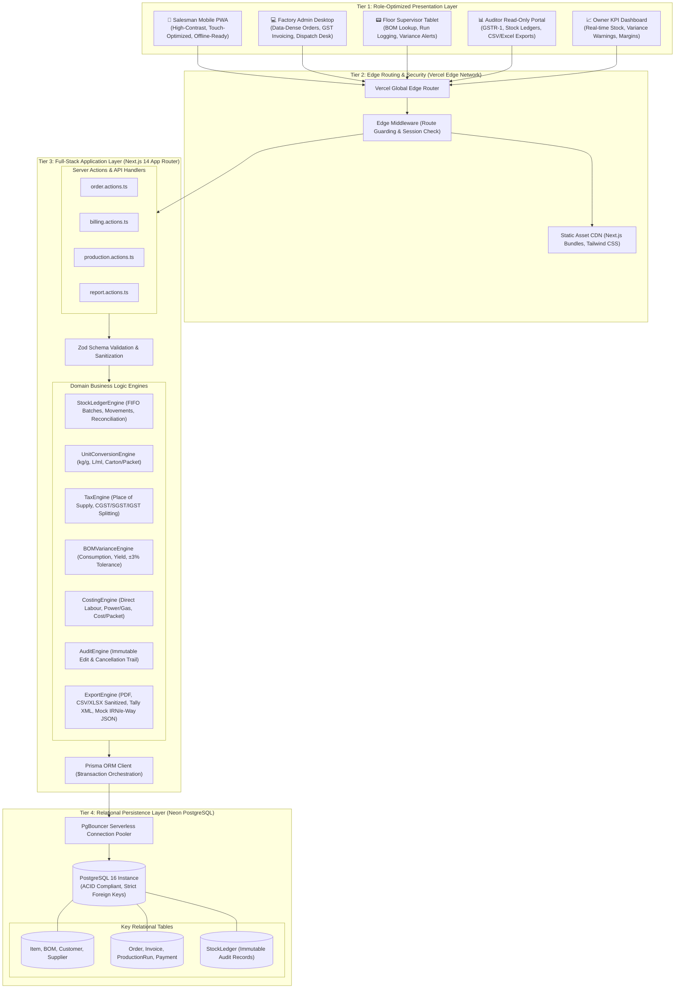
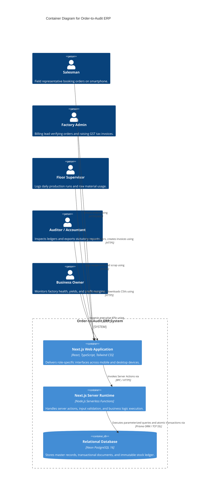

# System Architecture Specification

## 1. Executive Summary & Architectural Tenets
The Order-to-Audit ERP is an enterprise-grade, single-entry web platform designed for small-scale food manufacturing. The architecture resolves the traditional operational chasm between field sales, warehouse invoicing, recipe-based floor production, and statutory audit compliance.

### Core Architectural Tenets:
1. **Source-Level Single Entry:** Data is captured exclusively where the event occurs (e.g., salesman phone, factory weighing scale, billing desk).
2. **Immutable Inventory as a Ledger:** Inventory balances are never edited as bare numbers. All stock levels are derived from an append-only ledger of signed movements.
3. **Strict Decimal Arithmetic:** Currency and quantity computations use `decimal.js` / `Prisma.Decimal` on the server backed by PostgreSQL `Decimal(12, 2)` / `Decimal(12, 3)` to eliminate floating-point rounding drift.
4. **Zero-Hardcoding & Agility:** Business entities (products, BOM recipes, unit conversions, tax slabs, customer classifications, tolerance thresholds, company settings) are fully dynamic database entities.
5. **Zero-Cost & Local Deployability ($0):** Architecture runs 100% within free-tier serverless limits (Next.js on Vercel + PostgreSQL on Neon) **and** includes a single-command local `docker-compose.yml` setup (Next.js + PostgreSQL 16).

---

## 2. High-Level Multi-Tier Architecture

---

## 3. C4 Model: Container Architecture

---

## 4. Technical Stack Rationale & Cost Matrix

| Layer | Selected Technology | Technical Rationale | Operational Cost |
| :--- | :--- | :--- | :--- |
| **Frontend & Backend** | **Next.js 14+ (App Router, TypeScript)** | Unifies API and UI in a single repository. Server Actions provide type-safe, direct RPC without manual REST/GraphQL boilerplate. Server-side rendering ensures instant page loads. | **$0** (Free Tier on Vercel) |
| **Styling & Icons** | **Tailwind CSS + Lucide Icons** | Utility-first CSS creates clean enterprise UI with zero runtime CSS overhead. Highly responsive layout switches smoothly between mobile phones and multi-column desktop tables. | **$0** (Open Source) |
| **ORM & Migrations** | **Prisma ORM** | Type-safe schema definition with automated migration tracking. Built-in `$transaction` guarantees multi-table ACID atomicity when committing ledger debits. | **$0** (Open Source) |
| **Database** | **Neon Serverless PostgreSQL** | Production-grade PostgreSQL 16 with native connection pooling (`pgBouncer`). Auto-scales compute and isolates tenant storage. Free tier includes 0.5 GB storage (< 5 MB required for demo). | **$0** (Free Tier) |
| **Document Export** | **jsPDF & SheetJS (xlsx)** | Client/server generation of GST-compliant PDF tax invoices and Excel/CSV spreadsheets for tax auditors. | **$0** (Open Source) |
| **Hosting Platform** | **Vercel** | Global edge serverless hosting with continuous deployment from GitHub. Provides zero-configuration SSL certificates and instant public URL generation for evaluation. | **$0** (Hobby Plan) |

---

## 5. Scalability & Zero-Hardcoding Principles

To ensure production agility and prevent brittle code, all business entities are completely dynamic:
1. **Dynamic Master Catalog:** Products, packaging materials, and raw ingredients are rows in `Item`. No item codes or product names exist in application code.
2. **Configurable Bill of Materials (BOM):** Recipes support multi-ingredient and multi-packaging specifications with configurable yield ratios and individual tolerance thresholds (`BOM.tolerancePercent`).
3. **Pluggable Tax Rules:** Place of supply tax determination inspects `Customer.stateCode` vs. factory origin (`33` for Tamil Nadu). If matching, system splits `Item.taxRate` into equal CGST and SGST shares; if differing, charges full rate as IGST.
4. **Reproducible Benchmark Automation & Automated Test Suite:** All Section 5 benchmark data is isolated in `prisma/seed.ts` (`npx prisma db seed`). Automated Vitest unit & integration suites verify Decimal/GST math, unit conversion, FIFO concurrency, RBAC/IDOR rules, Credit Note restock logic, and the full 9-step Section 5 benchmark.
5. **Health & Observability:** `/api/health` validates database connectivity and ledger reconciliation invariants in real time.
