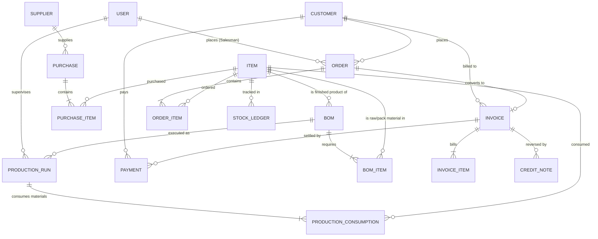

# Database Architecture & Data Dictionary

## 1. Overview & Storage Engine
The Order-to-Audit ERP utilizes **PostgreSQL 16** hosted on **Neon Serverless**, managed through **Prisma ORM**. The database is designed for financial-grade consistency, strict relational integrity, and statutory audit compliance.

### Core Database Tenets:
* **The Stock Ledger as Single Source of Truth:** Stock balances are never stored as mutable numbers in the product catalog. Every inventory movement is recorded as an immutable row in the `StockLedger` table.
* **Exact Decimal Types:** All financial values use `Decimal(12, 2)` (or integer paise) and physical measurements use `Decimal(12, 3)` to guarantee zero floating-point rounding errors.
* **ACID Transactions:** Multi-entity operations (e.g., Invoice generation + Stock deduction + Order status transition) execute atomically using `prisma.$transaction`.

---

## 2. Complete Entity-Relationship (ER) Diagram



---

## 3. Data Dictionary & Table Definitions

### 3.1 `User`
Stores system accounts and role designations for access control.
| Column | Type | Constraints | Description |
| :--- | :--- | :--- | :--- |
| `id` | `String` (UUID) | Primary Key | Unique user identifier. |
| `email` | `String` | Unique, Not Null | Login email address. |
| `password` | `String` | Not Null | Bcrypt hashed password. |
| `name` | `String` | Not Null | Full display name (e.g., "Salesman A", "Admin"). |
| `role` | `Role` (Enum) | Not Null | `SALESMAN`, `FACTORY_ADMIN`, `PRODUCTION_SUPERVISOR`, `AUDITOR`, `OWNER`. |
| `phone` | `String` | Nullable | Contact number for SMS / WhatsApp dispatch. |
| `active` | `Boolean` | Default: `true` | Account activation state. |
| `createdAt` | `DateTime` | Default: `now()` | Timestamp of account creation. |

### 3.2 `Customer`
Holds buyers (retailers and wholesale distributors) with GST profile.
| Column | Type | Constraints | Description |
| :--- | :--- | :--- | :--- |
| `id` | `String` (UUID) | Primary Key | Unique customer identifier. |
| `name` | `String` | Not Null | Business name (e.g., "Retailer A", "Distributor B"). |
| `type` | `CustomerType` | Not Null | `RETAILER` or `DISTRIBUTOR`. |
| `gstin` | `String` | Nullable | 15-character statutory GST identification number. |
| `state` | `String` | Not Null | State name (e.g., "Tamil Nadu", "Karnataka"). |
| `stateCode` | `String` | Not Null | 2-digit GST state code (`33` for TN, `29` for KA). |
| `phone` | `String` | Not Null | Primary phone for WhatsApp invoice sharing. |
| `address` | `String` | Not Null | Physical delivery and billing address. |
| `creditLimit`| `Decimal(12, 2)`| Default: `0.00` | Max authorized credit. |

### 3.3 `Supplier`
Master directory of raw material and packaging vendors.
| Column | Type | Constraints | Description |
| :--- | :--- | :--- | :--- |
| `id` | `String` (UUID) | Primary Key | Unique supplier identifier. |
| `name` | `String` | Not Null | Vendor company name. |
| `gstin` | `String` | Nullable | Supplier GSTIN. |
| `state` | `String` | Not Null | Supplier operating state. |
| `phone` | `String` | Nullable | Supplier contact phone. |

### 3.4 `Item` (Master Catalog)
Central catalog of raw materials, packaging supplies, and finished food products.
| Column | Type | Constraints | Description |
| :--- | :--- | :--- | :--- |
| `id` | `String` (UUID) | Primary Key | Unique item identifier. |
| `code` | `String` | Unique, Not Null | SKU Code (`RAW-FLOUR`, `PACK-POUCH-200`, `FG-MURUKKU-200`). |
| `name` | `String` | Not Null | Descriptive item name. |
| `category` | `ItemCategory` | Not Null | `RAW_MATERIAL`, `PACKAGING`, `FINISHED_GOOD`. |
| `unit` | `UnitType` | Not Null | `KG`, `LITRE`, `PIECE`, `PACKET`, `CARTON`. |
| `hsnCode` | `String` | Not Null | Statutory HSN classification code (e.g., `1905`). |
| `taxRate` | `Decimal(5, 2)` | Default: `5.00` | Applicable GST rate percentage. |
| `sellingPrice`| `Decimal(12, 2)`| Nullable | Unit sales price before tax (e.g., ₹50.00). |
| `reorderLevel`| `Decimal(12, 3)`| Default: `0.000`| Minimum stock threshold triggering low-stock alert. |

### 3.5 `BOM` (Bill of Materials) & `BOMItem`
Recipe specifications defining standard ingredient requirements per batch.
* **`BOM` Table:**
  * `id`: UUID (PK)
  * `finishedItemId`: FK $\rightarrow$ `Item.id`
  * `name`: Recipe name (e.g., "Standard Murukku 200g Recipe")
  * `batchSizeOutput`: `Decimal(12, 3)` (Standard expected yield, e.g., 200 packets)
  * `tolerancePercent`: `Decimal(5, 2)` (Variance threshold, default `3.00%`)
* **`BOMItem` Table:**
  * `id`: UUID (PK)
  * `bomId`: FK $\rightarrow$ `BOM.id`
  * `itemId`: FK $\rightarrow$ `Item.id` (Raw material or packaging item)
  * `standardQty`: `Decimal(12, 3)` (Standard requirement per batch, e.g., 40.0 kg flour, 10.0 L oil, 1.2 kg spices)
  * `unit`: `UnitType`

### 3.6 `ProductionRun` & `ProductionConsumption`
Records daily batch execution, actual consumption, yield, scrap, and overheads.
* **`ProductionRun` Table:**
  * `id`: UUID (PK)
  * `runNumber`: String (Unique, e.g., `PR-2024-001`)
  * `bomId`: FK $\rightarrow$ `BOM.id`
  * `supervisorId`: FK $\rightarrow$ `User.id`
  * `runDate`: DateTime
  * `plannedOutput`: `Decimal(12, 3)` (e.g., 200 packets)
  * `actualOutput`: `Decimal(12, 3)` (e.g., 188 packets)
  * `yieldVariancePercent`: `Decimal(6, 2)` (e.g., `-6.00%`)
  * `varianceFlagged`: Boolean (True if $|variance| > tolerance$)
  * `labourCost`: `Decimal(12, 2)` (Direct labour, e.g., ₹1,200.00)
  * `powerGasCost`: `Decimal(12, 2)` (Power/Gas, e.g., ₹600.00)
  * `totalRunCost`: `Decimal(12, 2)` (Total batch expenses = Materials + Packaging + Overheads)
  * `costPerPacket`: `Decimal(12, 2)` (Unit cost = `totalRunCost / actualOutput` = ₹30.90)
* **`ProductionConsumption` Table:**
  * `id`: UUID (PK)
  * `productionRunId`: FK $\rightarrow$ `ProductionRun.id`
  * `itemId`: FK $\rightarrow$ `Item.id`
  * `plannedQty`: `Decimal(12, 3)`
  * `actualIssuedQty`: `Decimal(12, 3)` (e.g., 10.5 L oil)
  * `scrapDamagedQty`: `Decimal(12, 3)` (e.g., 6 damaged pouches)
  * `variancePercent`: `Decimal(6, 2)` (e.g., `+5.00%` for oil)
  * `varianceFlagged`: Boolean

### 3.7 `Order` & `OrderItem`
Field orders submitted by salesmen.
* **`Order` Table:**
  * `id`: UUID (PK)
  * `orderNumber`: String (Unique, e.g., `ORD-2024-001`)
  * `salesmanId`: FK $\rightarrow$ `User.id`
  * `customerId`: FK $\rightarrow$ `Customer.id`
  * `orderDate`: DateTime
  * `status`: `OrderStatus` (`SUBMITTED`, `APPROVED`, `REJECTED`, `INVOICED`, `DISPATCHED`, `CANCELLED`)
  * `totalAmount`: `Decimal(12, 2)`
* **`OrderItem` Table:**
  * `id`: UUID (PK)
  * `orderId`: FK $\rightarrow$ `Order.id`
  * `itemId`: FK $\rightarrow$ `Item.id`
  * `quantity`: `Decimal(12, 3)`
  * `unitPrice`: `Decimal(12, 2)`
  * `totalAmount`: `Decimal(12, 2)`

### 3.8 `Invoice`, `InvoiceItem` & `CreditNote`
Statutory GST Tax Invoices generated upon order approval.
* **`Invoice` Table:**
  * `id`: UUID (PK)
  * `invoiceNumber`: String (Unique, e.g., `INV/2024-25/0001`)
  * `orderId`: FK $\rightarrow$ `Order.id` (Unique)
  * `customerId`: FK $\rightarrow$ `Customer.id`
  * `invoiceDate`: DateTime
  * `placeOfSupply`: String (e.g., "Tamil Nadu" or "Karnataka")
  * `taxableAmount`: `Decimal(12, 2)` (e.g., ₹7,500.00)
  * `cgstAmount`: `Decimal(12, 2)` (e.g., ₹187.50)
  * `sgstAmount`: `Decimal(12, 2)` (e.g., ₹187.50)
  * `igstAmount`: `Decimal(12, 2)` (e.g., ₹0.00)
  * `totalAmount`: `Decimal(12, 2)` (e.g., ₹7,875.00)
  * `status`: `InvoiceStatus` (`POSTED`, `CANCELLED`)
* **`CreditNote` Table (Reversal Tracking):**
  * `id`: UUID (PK)
  * `invoiceId`: FK $\rightarrow$ `Invoice.id`
  * `amount`: `Decimal(12, 2)`
  * `reason`: String (Documented cancellation explanation)
  * `issuedAt`: DateTime

### 3.9 `Payment`
Payment collections recorded against customer invoices.
* `id`: UUID (PK)
* `customerId`: FK $\rightarrow$ `Customer.id`
* `invoiceId`: FK $\rightarrow$ `Invoice.id` (Nullable)
* `paymentDate`: DateTime
* `amount`: `Decimal(12, 2)` (e.g., ₹4,000.00)
* `paymentMode`: `PaymentMode` (`CASH`, `UPI`, `BANK_TRANSFER`, `CHEQUE`)
* `referenceNumber`: String (Transaction ID / UTR)

### 3.10 `StockLedger` (The Core Inventory Engine)
Every physical inventory increment or decrement writes an immutable row here.
| Column | Type | Constraints | Description |
| :--- | :--- | :--- | :--- |
| `id` | `String` (UUID) | Primary Key | Unique ledger transaction identifier. |
| `timestamp` | `DateTime` | Default: `now()` | Exact time movement was committed. |
| `itemId` | `String` | FK $\rightarrow$ `Item.id` | Inventory item moved. |
| `movementType` | `MovementType` | Not Null | `OPENING_BALANCE`, `PURCHASE_RECEIPT`, `PRODUCTION_ISSUE`, `PRODUCTION_OUTPUT`, `DISPATCH_SALE`, `SCRAP_DAMAGE`, `STOCK_ADJUSTMENT`. |
| `quantity` | `Decimal(12, 3)` | Signed | **Positive** for additions, **Negative** for reductions. |
| `unit` | `UnitType` | Not Null | Unit of measure. |
| `referenceType` | `RefType` | Not Null | `OPENING`, `PURCHASE`, `PRODUCTION_RUN`, `INVOICE`, `ADJUSTMENT`. |
| `referenceId` | `String` | Not Null | Foreign ID of the source transaction document. |
| `balanceAfter` | `Decimal(12, 3)` | Not Null | Snapshot of running closing balance post-transaction. |
| `unitRate` | `Decimal(12, 2)` | Nullable | Valuation unit cost under FIFO. |
| `totalValue` | `Decimal(12, 2)` | Nullable | Total transactional financial value (`quantity * unitRate`). |
| `notes` | `String` | Nullable | Reason for manual adjustments or scrap details. |

---

## 4. Indexing Strategy & Query Optimization

To ensure sub-second response times on reports and prevent table scans as ledger rows grow:
1. **`StockLedger` Compound Index:**
   `@@index([itemId, timestamp(sort: Desc)])`
   * Accelerates instant closing balance calculations and stock ledger timeline queries.
2. **`StockLedger` Reference Lookup:**
   `@@index([referenceType, referenceId])`
   * Speeds up source-document traceability lookups (e.g., viewing all movements created by `PR-2024-001`).
3. **`Invoice` Date Range & Customer Index:**
   `@@index([customerId, invoiceDate])`
   `@@index([status, invoiceDate])`
   * Optimizes GSTR-1 outward supply summaries and customer aging calculations.
4. **`Order` Queue Index:**
   `@@index([status, orderDate(sort: Desc)])`
   * Powers the factory admin incoming order queue.

---

## 5. Ledger Invariants & SQL Verification Queries

### Invariant 1: Stock Ledger Reconciliation
The derived stock balance of any item must strictly match the sum of signed quantities:
```sql
SELECT 
    i.code, 
    i.name, 
    COALESCE(SUM(sl.quantity), 0) AS calculated_closing_balance
FROM "Item" i
LEFT JOIN "StockLedger" sl ON i.id = sl."itemId"
GROUP BY i.id, i.code, i.name;
```

### Invariant 2: Customer Debtors & Outstanding Balance
Customer outstanding balance must equal posted invoices minus confirmed collections:
```sql
SELECT 
    c.id, 
    c.name, 
    COALESCE(SUM(i."totalAmount"), 0) - COALESCE(SUM(p.amount), 0) AS total_receivable
FROM "Customer" c
LEFT JOIN "Invoice" i ON c.id = i."customerId" AND i.status = 'POSTED'
LEFT JOIN "Payment" p ON c.id = p."customerId"
GROUP BY c.id, c.name;
```

---

## 6. Benchmark Seed Script Architecture (`prisma/seed.ts`)

The database architecture features an automated seed script that loads the exact Section 5 benchmark data:
1. **Cleans database tables** in reverse foreign-key order.
2. **Seeds 5 Roles:** Salesman A, Salesman B, Factory Admin, Floor Supervisor, Auditor, Owner.
3. **Seeds Customers:** Retailer A (Tamil Nadu, state code `33`), Distributor B (Karnataka, state code `29`).
4. **Seeds Items:** Flour, Cooking Oil, Spice Mix, 200g Pouch, Outer Carton, Finished Murukku 200g.
5. **Seeds BOM Recipe:** Murukku 200g standard recipe (40kg flour, 10L oil, 1.2kg spices, 200 pouches, 10 cartons $\rightarrow$ 200 packets yield).
6. **Seeds Opening Inventory in `StockLedger`:** 100 kg flour, 30 L oil, 5 kg spices, 500 pouches, 30 cartons, 50 packets Murukku 200g.
