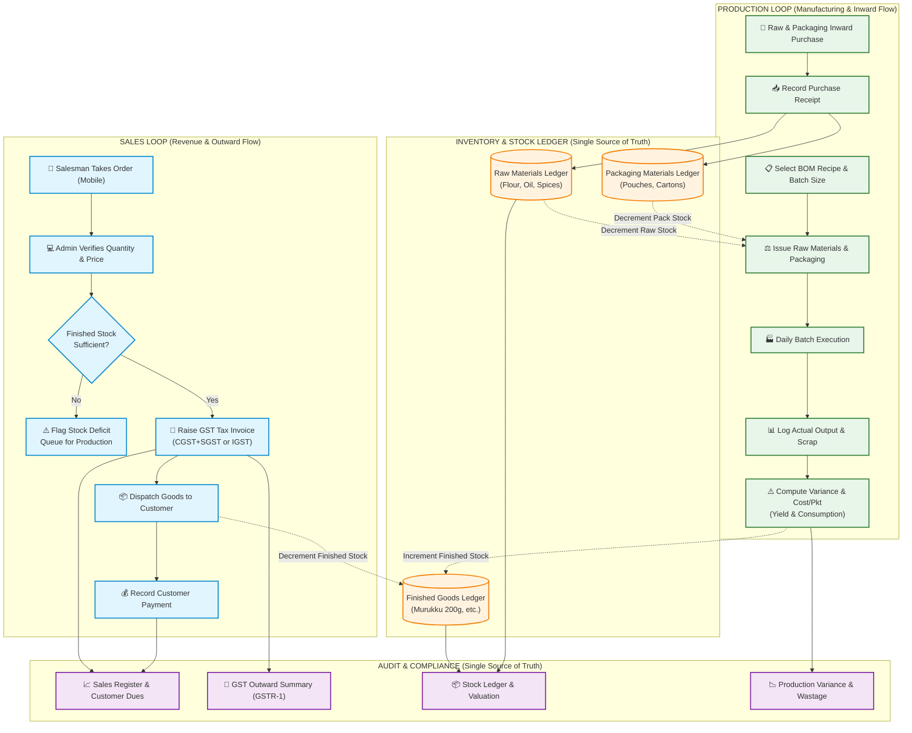
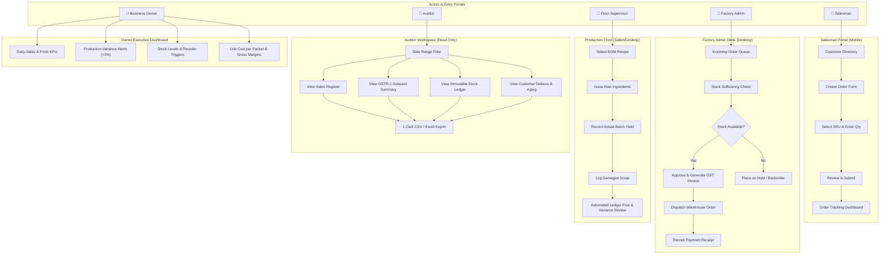
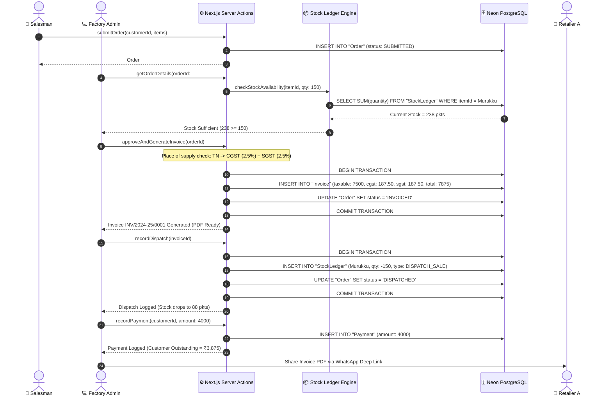
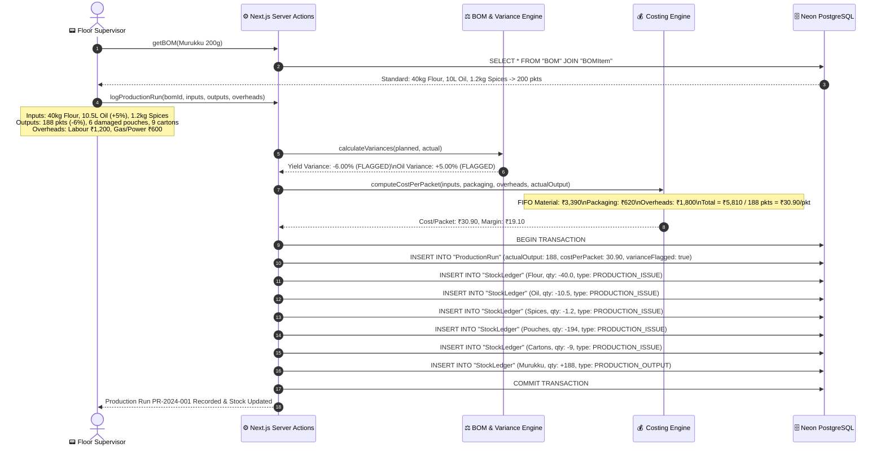
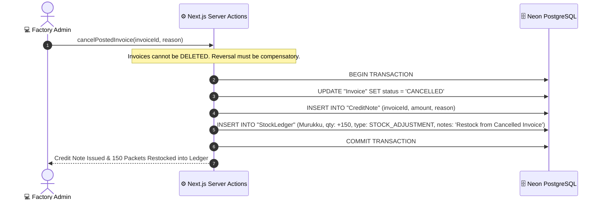
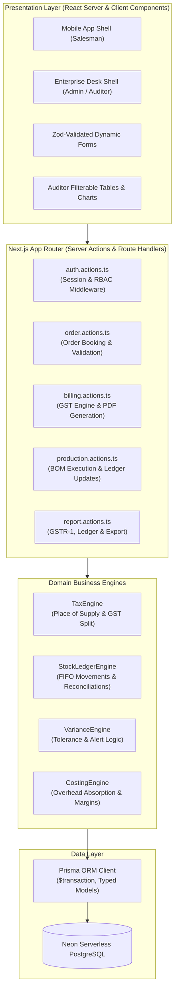
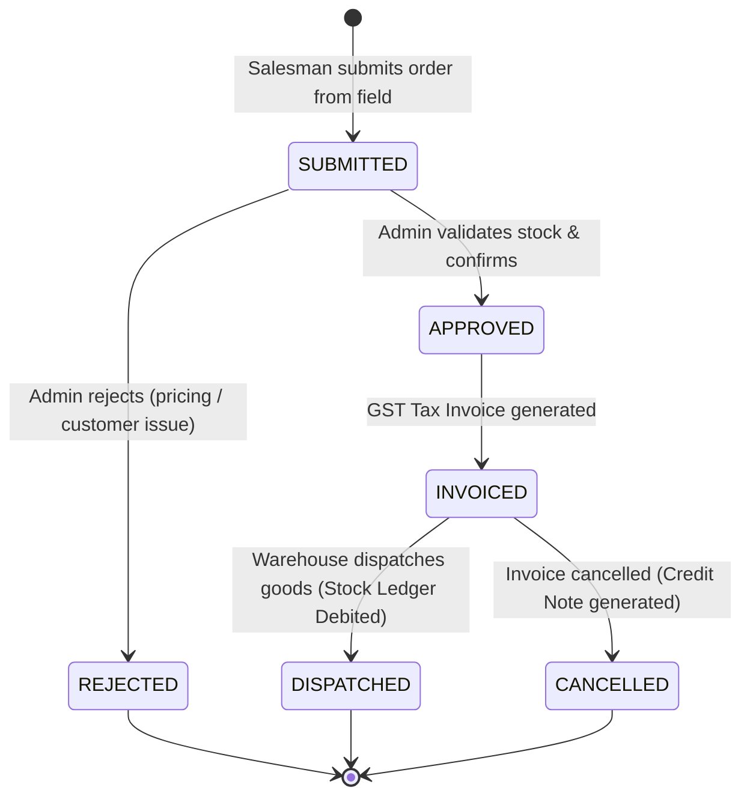
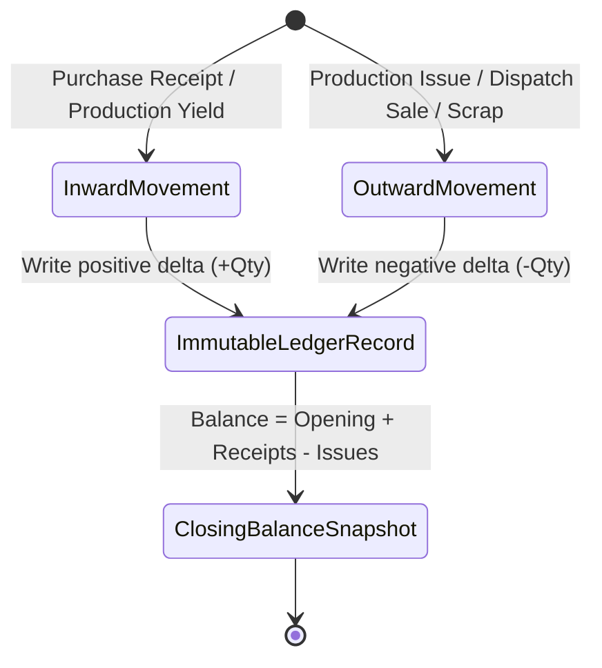

# Visual System Design & Diagram Suite

## 1. Overview
This document provides a comprehensive visual engineering specification for the Order-to-Audit ERP. It includes business architecture flows, user stories with acceptance criteria, role-based use case flows, sequence diagrams, component architectures, and UML state machines.

---

## 2. Business Architecture Flow (Dual-Loop Integration)

---

## 3. User Stories & Acceptance Criteria

### US-1: Field Salesman Order Booking
* **As a** field salesman visiting retailers,
* **I want to** select a customer from my territory, pick products, specify quantities, and tap submit on my smartphone,
* **So that** orders enter the factory queue instantly without phone calls or WhatsApp messages.
* **Acceptance Criteria (Given-When-Then):**
  * *Given* I am logged in as a Salesman on a mobile device,
  * *When* I select "Retailer A", add 150 packets of "Murukku 200g", and submit,
  * *Then* the order is saved with status `SUBMITTED`, total taxable value is calculated at ₹7,500, and a success notification appears in < 60 seconds.

### US-2: Admin Verification & Real-time Stock Check
* **As a** factory admin,
* **I want to** view incoming orders and immediately see if warehouse finished stock covers the ordered quantity,
* **So that** I do not commit to delivery when inventory is insufficient.
* **Acceptance Criteria:**
  * *Given* an order from "Distributor B" for 120 packets of Murukku 200g arrives,
  * *When* the current available finished stock is 88 packets,
  * *Then* the system alerts: "Insufficient Stock! Shortage of 32 packets", preventing blind dispatch until new stock is produced.

### US-3: GST Tax Invoicing & WhatsApp Sharing
* **As a** factory admin,
* **I want to** convert an approved order into a GST tax invoice with 1 click,
* **So that** the invoice applies the correct place-of-supply tax split (CGST+SGST for Tamil Nadu, IGST for Karnataka) and can be shared via WhatsApp.
* **Acceptance Criteria:**
  * *Given* an approved order for Retailer A (Tamil Nadu),
  * *When* I generate the invoice,
  * *Then* the invoice shows 2.5% CGST (₹187.50) + 2.5% SGST (₹187.50) on ₹7,500 taxable value = ₹7,875 total, assigns sequential number `INV/2024-25/0001`, and provides a direct WhatsApp share link.

### US-4: Recipe (BOM) Production & Variance Tracking
* **As a** production supervisor,
* **I want to** execute a daily batch run against a BOM and enter actual inputs, outputs, and packaging scrap,
* **So that** raw materials decrement, finished goods increment, and variances beyond $\pm 3\%$ are automatically flagged.
* **Acceptance Criteria:**
  * *Given* standard BOM for Murukku 200g expects 200 packets from 40kg flour, 10L oil, and 1.2kg spices,
  * *When* I enter actual output of 188 packets and 10.5L oil issued,
  * *Then* the system flags Yield Variance at **-6.00%** (Loss Alert) and Oil Consumption Variance at **+5.00%** (Over-consumption Alert), while auto-updating raw and finished stock ledgers.

### US-5: Unit Costing with Direct Overheads
* **As a** business owner,
* **I want to** absorb direct labour (₹1,200) and power/gas (₹600) into the batch run,
* **So that** I see the true cost per packet and gross profit margin against the ₹50 selling price.
* **Acceptance Criteria:**
  * *Given* total run expenses of ₹5,810 (Raw ₹3,390 + Packaging ₹620 + Overheads ₹1,800),
  * *When* divided across 188 marketable packets,
  * *Then* cost per packet is displayed as **₹30.90**, showing a unit gross margin of **₹19.10 (38.2%)**.

---

## 4. Use Case & Flow Diagrams

---

## 5. Sequence Diagrams

### 5.1 Sales-to-Invoice Sequence (Sales Loop)

### 5.2 Recipe-to-Stock Sequence (Production Loop)

### 5.3 Error Reversal & Compensating Adjustment Sequence

---

## 6. Component Architecture Diagram

---

## 7. UML State Machine Diagrams

### 7.1 Order Lifecycle State Machine

### 7.2 Stock Ledger Movement Lifecycle

