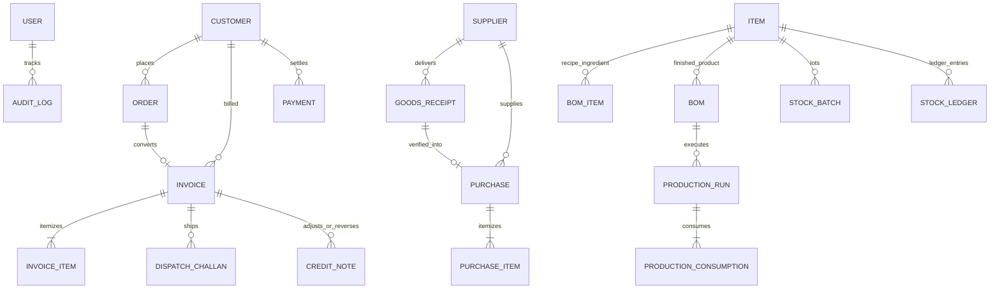

# Design Note: Nittin Order-to-Audit ERP

**Business Domain:** Packaged Food Manufacturing (**Nittin Foods Pvt. Ltd.**, Tamil Nadu)  
**System Scope:** Order-to-Audit (Field Sales, Gate GRN, BOM Production, FIFO/FEFO Stock Ledger, GST Billing, Analytics & Audit Compliance)

---

## 1. System Narrative & Design Philosophy

Small-scale snack manufacturers often run sales on WhatsApp, recipes in notebooks, factory stock in tally sheets, and billing in disconnected software. **Nittin ERP** solves this with **Single-Entry Operations**:
* A **Field Salesman** captures an order once on mobile (even offline via IndexedDB).
* The **Floor Supervisor** logs gate deliveries (`GRN`, without vendor pricing) and daily **BOM Batch Runs** (catching oil/yield variance at source).
* The **Factory Admin** verifies GRNs into vendor bills, approves orders against live stock, raises GST invoices, dispatches split/full Delivery Challans, and collects payments.
* The **Auditor** inspects immutable statutory registers (`GSTR-1/3B`, `StockLedger`, `AuditLog`) and exports Excel/PDF/Tally XML.
* The **Business Owner** governs Company Legal/GST settings and Factory Admins while monitoring real-time operations, monthly/yearly analytics charts, and audit trails.

---

## 2. Architecture & Relational Data Model

Built with **Next.js 15.5+ (App Router, Server Actions, TypeScript)**, **Tailwind CSS v4**, and **PostgreSQL 16 (Neon Serverless / Docker Postgres)** via **Prisma ORM**.

### Core Architectural Decisions
1. **Ledger + Batch Single Source of Truth:** There is no editable `stock` column on `Item`. All stock balances come from an append-only `StockLedger` backed by FIFO/FEFO `StockBatch` lots locked inside `prisma.$transaction` (`SELECT ... FOR UPDATE`).
2. **Zero-Float Server Math:** All monetary (`Decimal(12, 2)`) and physical (`Decimal(12, 3)`) math executes server-side using `decimal.js` / `Prisma.Decimal` with canonical unit conversions (`kg`/`g`, `L`/`ml`, `carton`/`packet`).
3. **Top-Level Owner Governance & 5 Strict Portals:**
   * **`OWNER` (`/dashboard`, `/dashboard/reports`, `/dashboard/audit`, `/dashboard/team`):** Bootstrapped via environment credentials (`BOOTSTRAP_OWNER_*` with in-app password change/reset disabled). Manages Company GST settings and `FACTORY_ADMIN`/`AUDITOR` accounts, plus executive KPIs, monthly/yearly visualizations, and read-only audit oversight.
   * **`FACTORY_ADMIN` (`/admin/*`):** Order verification, GST invoicing, partial/full dispatch, sales returns & credit notes, GRN-to-Purchase billing (raw/packaging only), payments, stock adjustments, read-only `/admin/boms`, and operational masters.
   * **`PRODUCTION_SUPERVISOR` (`/production/*`):** Gate `GRN` intake (pricing-blind), BOM recipe management/scaling, and 1-step/2-step production runs with ±3% variance detection.
   * **`SALESMAN` (`/salesman/*`):** Touch-first order entry with offline `IndexedDB` queuing (`clientRequestId` idempotency) and offline navigation guards.
   * **`AUDITOR` (`/auditor/*`):** Strictly read-only statutory registers, reconciled ledger, receivables ageing, audit trail, and Excel/CSV/PDF/Tally XML exports.

---

## 3. Inventory Ledger, Production Variance & Costing

### 3.1 Immutable Stock Ledger Invariant
$$\text{Current Balance}_i = \sum_{j=1}^{N} \Delta Q_{i,j}$$
Movements include `OPENING_BALANCE`, `PURCHASE_RECEIPT` (+), `PRODUCTION_ISSUE` (-), `PRODUCTION_OUTPUT` (+), `DISPATCH_SALE` (- via `DispatchChallan`), `SALES_RETURN` (+ for `RESALEABLE` returns only), `SCRAP_DAMAGE` (-), and audited `STOCK_ADJUSTMENT`.

### 3.2 BOM Variance & Overhead Allocation
$$\text{Yield Variance \%} = \left(\frac{\text{Actual Output} - \text{Planned Output}}{\text{Planned Output}}\right) \times 100 \qquad \text{Consumption Variance \%} = \left(\frac{\text{Actual Input} - \text{Planned Input}}{\text{Planned Input}}\right) \times 100$$
* Breaches beyond default $\pm 3.00\%$ tolerance flag floor warnings and elevate to the Owner overview.
* FIFO consumes oldest active lots first (`100 kg @ ₹42` before `60 kg @ ₹45`).
* Batch overheads divide strictly over **actual marketable packets produced**:
$$\text{Cost Per Packet} = \frac{\text{Raw Materials} + \text{Packaging (Good + Scrap)} + \text{Labour} + \text{Power/Gas}}{\text{Actual Good Packets Produced}}$$

---

## 4. Non-Functional Requirements (NFR), Performance & Resilience
* **DB-Level Performance:** Composite indexes across hot query paths (`User[role, active]`, `Customer[active, assignedSalesmanId]`, `Item[active, category]`, `Purchase[purchaseDate]`, `Payment[paymentDate]`, `ProductionRun[status, runDate]`, `Invoice[status, dispatchStatus]` & `[status, paymentStatus]`, `StockBatch[remainingQty]` & `[expiryDate]`, `AuditLog[userId, createdAt]`).
* **Code-Level & Network Resilience:** `React.cache` request deduplication for server user verification (`src/lib/auth.ts`), DB-level open-invoice filtering on dashboards, `withDbRetry` transient Neon socket retry recovery (`src/lib/prisma.ts`), `/api/auth/logout` cookie clearing to eliminate auth redirect loops, and `toSafeErrorMessage` sanitization (`src/lib/errors.ts`) so internal Prisma/SQL errors never surface to users.
* **Security & SEO Hygiene:** CSP, HSTS, `X-Frame-Options: DENY`, `poweredByHeader: false`, `robots.txt` disallowing portals/APIs, `noindex` metadata on authenticated portals, and CWE-1236 spreadsheet sanitization.

---

## 5. Benchmark Verification Summary (`Section 5`)

*Seeded cleanly via `src/lib/demo-seed.ts` (including realistic shelf-life `expiryDate` lots and opening settled inward purchase `PUR/2026-27/0000` / `GRN/2026-27/0000` from Cauvery Flour & Agro Mills):*

| Check Point | Benchmark Expectation | Verified Output | Status |
| :--- | :--- | :--- | :---: |
| **Flour Closing Balance** | $100 + 60 - 40 = 120\text{ kg}$ | `120.000 kg` (FIFO: 60 @ ₹42 + 60 @ ₹45) | ✅ |
| **Cooking Oil Balance** | $30 - 10.5 = 19.5\text{ L}$ | `19.500 L` | ✅ |
| **Pouches Balance** | $500 - (188 + 6) = 306\text{ pcs}$ | `306 pcs` (`188` issue + `6` scrap) | ✅ |
| **Finished Goods (Post-Run $\rightarrow$ Dispatch)** | $50 + 188 - 150 = 88\text{ pkts}$ | `238 pkts` $\rightarrow$ `88 pkts` | ✅ |
| **Yield & Oil Variances** | $-6\%$ Yield / $+5\%$ Oil | `-6.00%` & `+5.00%` (Both Flagged) | ✅ |
| **Retailer A Invoice (TN `33`)** | ₹7,500 + 5% (CGST+SGST) | ₹7,500 + ₹187.50 + ₹187.50 = **₹7,875.00** | ✅ |
| **Retailer A Balance** | ₹7,875 − ₹4,000 paid | **₹3,875.00** | ✅ |
| **Distributor B Order (KA `29`)** | 120 ordered vs 88 available | **Shortage 32 pkts flagged**; `5% IGST` | ✅ |
| **Cost Per Packet** | Raw (₹3,390) + Pack (₹620) + OH (₹1,800) | $₹5,810 / 188 = \mathbf{₹30.90\text{ / packet}}$ (`38.20%` margin) | ✅ |
