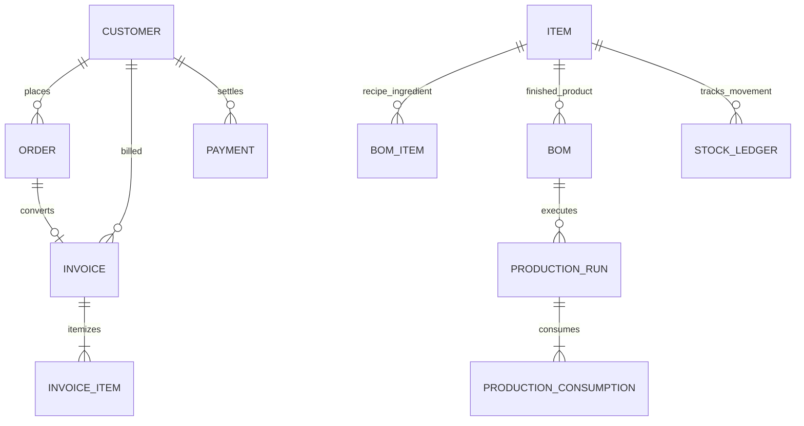

# Design Note: Order-to-Audit ERP System

**Candidate Submission — NIT Tiruchirappalli Internship Task**  
**Business Domain:** Packaged Food Manufacturing (Tamil Nadu)  
**System Scope:** Order-to-Audit (Sales, Production BOM, Stock Ledger, Costing, GST Reports)

---

## 1. System Architecture & Relational Data Model

The system is built as a cloud-native, responsive ERP using **Next.js 14 (App Router & Server Actions)**, **Tailwind CSS**, and **PostgreSQL (Neon Serverless)** mediated by **Prisma ORM**.

### Core Architectural Decisions
1. **Single Source of Truth (SSOT) Ledger:** There is no editable `stock` field in the catalog. All inventory balances are materialized strictly through an append-only `StockLedger` table.
2. **Paise/Decimal Arithmetic:** All currency calculations use high-precision decimals (`Decimal(12, 2)`) to eliminate floating-point rounding errors.
3. **Role-Based Isolation:** Dynamic role layouts:
   * **Salesman:** High-contrast, mobile-first view for fast order entry under poor network conditions.
   * **Factory Admin:** Order approval, stock sufficiency verification, GST tax invoicing, and dispatch.
   * **Production Supervisor:** Recipe (BOM) management, daily run logging, variance tracking.
   * **Auditor / Accountant:** Read-only access to sales, GST, stock ledger, and aging receivables with Excel/PDF export.
   * **Owner:** Executive dashboard with variance alerts, margin analysis, and receivables.

---

## 2. Inventory & Stock Ledger Computation

### 2.1 The Ledger Invariant
Inventory balance for item $i$ at time $t$ is computed via signed transactional deltas:

$$\text{Current Balance}_i = \sum_{j=1}^{N} \Delta Q_{i,j}$$

Every stock movement writes to `StockLedger` referencing its originating document:
* **`PURCHASE_RECEIPT` (+):** Triggered when inward raw materials/packaging are verified.
* **`PRODUCTION_ISSUE` (-):** Triggered when raw materials are issued to the production floor.
* **`PRODUCTION_OUTPUT` (+):** Triggered when finished goods are yielded from a production run.
* **`DISPATCH_SALE` (-):** Triggered upon invoice dispatch to a customer.
* **`SCRAP_DAMAGE` (-):** Written off for damaged packaging or production scrap.

### 2.2 Atomic Execution
When an admin approves and dispatches an invoice:
1. `Invoice` record status changes to `POSTED`.
2. `Order` status updates to `DISPATCHED`.
3. Outward debit rows are inserted into `StockLedger`.
All three steps execute inside a single atomic database transaction (`prisma.$transaction`).

---

## 3. BOM & Production Variance Engine

Each finished product defines a standard recipe (Bill of Materials) indicating standard quantities per batch and expected packet yield.

### 3.1 Variance Formulas & Thresholds
During a production run, actual inputs and outputs are recorded against standard recipe targets:

$$\text{Yield Variance \%} = \left(\frac{\text{Actual Output} - \text{Planned Output}}{\text{Planned Output}}\right) \times 100$$

$$\text{Consumption Variance \%} = \left(\frac{\text{Actual Input} - \text{Planned Input}}{\text{Planned Input}}\right) \times 100$$

* **Tolerance:** The system sets a default $\pm 3.00\%$ tolerance.
* **Automated Flagging:** When $| \text{Variance} | > 3.00\%$, the record is flagged in red on the floor supervisor screen and elevated to the Owner's dashboard.

---

## 4. Costing & Inventory Valuation Methodology

### 4.1 FIFO (First-In, First-Out) Valuation
Food manufacturing raw materials are subject to natural shelf-life constraints and price volatility. We implement **FIFO** valuation:
* Raw materials are consumed from the oldest active purchase batches.
* In the benchmark scenario:
  * Opening Flour: 100 kg @ ₹42/kg.
  * Inward Flour Purchase: 60 kg @ ₹45/kg.
  * Issuing 40 kg consumes from the opening lot @ **₹42/kg** = **₹1,680.00**.

### 4.2 Overhead Allocation Rule
Total batch manufacturing cost aggregates direct materials, packaging, and factory floor overheads:

$$\text{Total Batch Cost} = \text{Raw Materials} + \text{Packaging (Good + Scrap)} + \text{Direct Overheads}$$

$$\text{Cost Per Packet} = \frac{\text{Total Batch Cost}}{\text{Actual Good Packets Produced}}$$

Dividing by **actual good packets (188)** rather than standard batch size (200) ensures that production inefficiencies and yield loss are correctly absorbed into inventory valuation rather than masked.

---

## 5. GST Compliance & Audit Trail

1. **Place of Supply Tax Engine:**
   * **Intra-State (Tamil Nadu):** 5% GST split equally as **2.5% CGST** and **2.5% SGST**.
   * **Inter-State (e.g., Karnataka):** 5% charged as **IGST**.
2. **Immutable Audit Trail:**
   * Invoices cannot be deleted. Any billing error is rectified through a credit note, leaving a permanent ledger record for statutory auditors.
   * GSTR-1 and GSTR-3B summary formats map directly to statutory Indian tax returns.

---

## 6. Section 5 Benchmark Verification Summary

| Check Point | Benchmark Specification | System Computation | Status |
| :--- | :--- | :--- | :---: |
| **Flour Closing Balance** | $100 + 60 - 40 = 120\text{ kg}$ | $120.000\text{ kg}$ | ✅ Match |
| **Cooking Oil Balance** | $30 - 10.5 = 19.5\text{ L}$ | $19.500\text{ L}$ | ✅ Match |
| **Pouches Balance** | $500 - (188 + 6) = 306\text{ pcs}$ | $306\text{ pcs}$ | ✅ Match |
| **Finished Goods Post-Run** | $50 + 188 = 238\text{ pkts}$ | $238\text{ pkts}$ | ✅ Match |
| **Finished Goods Post-Dispatch** | $238 - 150 = 88\text{ pkts}$ | $88\text{ pkts}$ | ✅ Match |
| **Yield Variance** | 188 vs 200 expected | **-6.00%** (Flagged Alert) | ✅ Match |
| **Oil Consumption Variance** | 10.5 vs 10.0 expected | **+5.00%** (Flagged Alert) | ✅ Match |
| **Retailer A Invoice (TN)** | ₹7,500 Taxable + 5% GST | ₹7,500 + ₹187.50 CGST + ₹187.50 SGST = **₹7,875.00** | ✅ Match |
| **Retailer A Outstanding** | ₹7,875 invoice − ₹4,000 paid | **₹3,875.00** | ✅ Match |
| **Distributor B Order Check** | 120 pkts ordered vs 88 stock | **Shortage of 32 pkts flagged**; IGST flagged | ✅ Match |
| **Cost Per Packet** | Raw (₹3,390) + Pack (₹620) + Overheads (₹1,800) | $₹5,810 / 188 = \mathbf{₹30.90\text{ / packet}}$ (FIFO absorbed) | ✅ Match |
