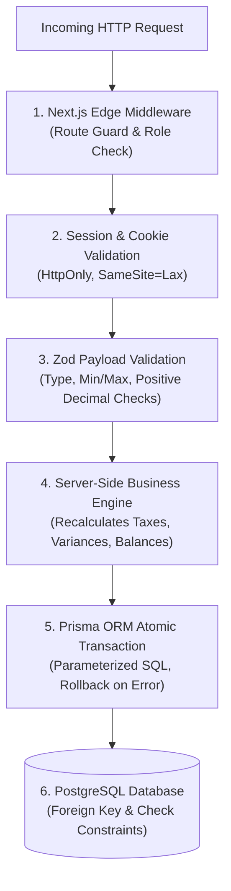

# Security Architecture & Threat Model

## 1. Executive Summary

This document outlines the security architecture, threat model, and defense mechanisms implemented across the Order-to-Audit ERP. Security is designed in depth, extending significantly beyond superficial Role-Based Access Control (RBAC) to protect data integrity, prevent unauthorized access, and ensure statutory audit compliance.

---

## 2. Threat Modeling & Defense Matrix (OWASP Top 10 Mapping)

| Threat Category | Potential Risk Vector | Implemented Defense Mechanism |
| :--- | :--- | :--- |
| **A01: Broken Access Control** | Salesman viewing admin reports; unauthorized user accessing production logs. | Next.js Edge Middleware route guards combined with server-side session and role validation in every Server Action. |
| **A02: Cryptographic Failures** | Plaintext password storage; credential leakage in transit. | Bcrypt/Argon2 password hashing with salt; strict TLS/HTTPS enforcement on Vercel; HTTP-only secure cookies. |
| **A03: Injection (SQL / Command)** | Attacker injecting SQL via order forms or report filters. | 100% parameterized queries via Prisma ORM. Direct raw string interpolation in SQL is strictly prohibited. |
| **A04: Insecure Design** | Negative inventory balance manipulation; tampering with calculated invoice amounts. | Strict server-side Zod validation schemas; calculations performed exclusively on the server (client inputs only item IDs & quantities). |
| **A05: Security Misconfiguration** | Leaked database credentials; exposed staging keys. | Environment variables (`.env`) isolated via Vercel secrets; zero secret commits in Git (`.gitignore` enforced). |
| **A07: Identification & Auth Failures** | Brute force login; session hijacking; deactivated user retaining cookie. | Signed `jose` HS256 JWT in `HttpOnly`, `SameSite=Lax`, `Secure` cookies verified at Edge; DB-backed `failedLoginAttempts`/`lockedUntil` (5 tries $\rightarrow$ 15 min lock) and `tokenVersion` + `User.active` check on Server Actions. |
| **A08: Software & Data Integrity Failures** | Direct tampering of stock records, master deletion, or CSV/Excel formula injection. | Immutable Stock Ledger design; soft deactivation (`active = false`) for masters; Credit Notes (restocking only if dispatched); CSV/Excel cell sanitization against `=`, `+`, `-`, `@` injection (CWE-1236). |
| **A09: Security Logging & Monitoring** | Untracked modifications to financial invoices or production formulas. | Dedicated `AuditLog` table recording before/after diffs, `userId`, `reason`, and timestamps on every edit or cancellation, plus `createdAt`/`createdById` across all transaction tables and `/api/health` diagnostics. |

---

## 3. Defense-in-Depth Implementation

---

## 4. Key Security Controls

### 4.1 Input Validation & Payload Sanitization (Zod)
Client-side validation is treated strictly as UX guidance. All Server Actions mandate server-side schema verification using **Zod**:
* Enforces positive values for quantities and prices (e.g., `z.number().positive()`).
* Rejects unexpected fields to prevent Mass Assignment vulnerabilities.
* Validates state codes, GSTIN patterns, and email formats.

### 4.2 SQL Injection Immunity
All database interactions flow through **Prisma ORM**, which compiles queries into parameterized SQL statements with bound values.
* User inputs are never concatenated directly into query strings.
* Any complex analytical queries use typed Prisma query APIs or strictly parameterized `$queryRaw`.

### 4.3 Session, Edge Auth & Brute-Force Protection
* **Two-Layer Session Verification:**
  * **Edge Middleware (`jose` HS256 JWT):** Verifies the signed `HttpOnly`, `Secure` (in HTTPS/production), `SameSite=Lax` session cookie without opening TCP connections in Edge Runtime, redirecting unauthenticated or wrong-role requests before rendering.
  * **Server Action / RSC Guard:** Reads `User.active` and compares `session.tokenVersion === user.tokenVersion` from PostgreSQL on every privileged action/mutation so deactivated accounts or password resets invalidate existing sessions immediately.
* **Serverless-Safe Account Lockout & Rate Limiting:** Failed login attempts increment `User.failedLoginAttempts` in PostgreSQL; after 5 consecutive failures, `User.lockedUntil` is set to `+15 minutes`. Sliding-window rate limiting (`src/lib/rate-limit.ts`) also throttles repeated login, forgot-password, and demo-reset bursts.
* **Self-Service & Admin Password Recovery:** Users submit non-enumerating Forgot Password requests (`PasswordResetRequest`) from `/login` and can rotate their own credentials (`changeOwnPasswordAction`, enforcing 8+ char alphanumeric policy). `FACTORY_ADMIN` resolves pending resets via `adminResetUserPasswordAction`, setting `mustChangePassword = true` and incrementing `tokenVersion` to revoke prior sessions immediately.

### 4.4 RBAC Permission Matrix & Strict Portal Isolation
Every Server Action, Layout, and Edge Middleware rule enforces strict **1-role-per-portal** boundaries and ownership scoping:

| Role | Portal Prefix & Allowed Mutations | Read Scope & IDOR Rules |
| :--- | :--- | :--- |
| **`SALESMAN`** | `/salesman/*` — Create/cancel own submitted `Order` (assigned/open customers). | **Strictly scoped:** Reads only `Order` records where `order.salesmanId === session.userId`. Cannot view factory costs, supplier bills, or admin/audit portals. |
| **`FACTORY_ADMIN`** | `/admin/*` — Approve/edit/hold/reject orders, issue/dispatch (partial or full) invoices, sales returns & credit notes, verify floor GRNs into purchases, payments, stock adjustments, operational masters, and floor/sales staff accounts (`SALESMAN`, `PRODUCTION_SUPERVISOR`, `AUDITOR`). | Scoped strictly to `/admin/*`; blocked from modifying/resetting `OWNER` or sibling `FACTORY_ADMIN` accounts; all edits/resets log `AuditLog` entries. |
| **`PRODUCTION_SUPERVISOR`** | `/production/*` — Create/edit `BOM`, start/complete `ProductionRun`, and log physical gate `GoodsReceipt` (GRN) deliveries. | Can read items, stock levels, BOMs, runs, and own/floor GRNs; cannot enter vendor rates/payments or access billing/admin/audit routes. |
| **`AUDITOR`** | `/auditor/*` — **None (Strictly Read-Only).** Blocked from all mutating Server Actions. | Read & export access to all 6 statutory reports, `AuditLog`, and Tally exports. |
| **`OWNER`** | `/dashboard`, `/dashboard/team` — Top-level governance: create/manage `FACTORY_ADMIN` & `AUDITOR` accounts, reset admin passwords, and manage Company GST Profile (`CompanySettings`). | Full executive visibility across KPIs, stock health, unit margins, variance alerts, and receivables without transactional clutter. |

### 4.5 Non-Destructive Ledger, Master Deactivation & Export Sanitization
* **No `DELETE` Operations:** `Invoice`, `DispatchChallan`, `StockLedger`, `ProductionRun`, `Purchase`, `GoodsReceipt`, `CreditNote`, and `AuditLog` rows are never hard-deleted. Masters (`User`, `Customer`, `Supplier`, `Item`, `BOM`) use `active = false` soft deactivation so historical ledger references remain intact.
* **Compensating Reversals:** Cancelled invoices and partial sales returns generate sequential `CreditNote` documents—cancellations restock only quantities previously dispatched, and sales returns restock only `RESALEABLE` items (keeping `DAMAGED` scrap separate).
* **CSV/Excel Formula Injection Guard (CWE-1236):** Export utilities neutralize any string cell beginning with `=`, `+`, `-`, `@`, `\t`, or `\r` by prefixing a single quote (`'`) before generating CSV/XLSX files.

### 4.6 Secret Management, HTTP Security Headers & Zero-Cost Security
* Production credentials (`DATABASE_URL`, `SESSION_SECRET`) are stored in Vercel’s encrypted environment variables (`sslmode=require` to Neon PostgreSQL).
* **Mandatory Security Headers:** Configured in `next.config.ts`: `X-Frame-Options: DENY`, `X-Content-Type-Options: nosniff`, `X-DNS-Prefetch-Control: off`, `Referrer-Policy: strict-origin-when-cross-origin`, `Cross-Origin-Opener-Policy: same-origin`, `Strict-Transport-Security`, `Permissions-Policy`, and `Content-Security-Policy`.

### 4.7 Demo Mode Guard, Idempotency & Concurrency Locks
* **Demo Switcher & Seed Reset Gating:** 1-click role-switcher buttons on `/login` are enabled only when `ENABLE_DEMO_MODE="true"`, and the benchmark seed-reset action requires both `ENABLE_DEMO_MODE="true"` and explicit confirmation/admin authorization so production data can never be wiped by unauthenticated visitors.
* **Offline Sync Idempotency:** Mobile field orders include a unique `clientRequestId` UUID generated on the client so intermittent 3G/4G retries never create duplicate orders.
* **Transactional Stock Locking:** FIFO `StockBatch` deductions execute inside `prisma.$transaction` with row-level locks (`SELECT ... FOR UPDATE`) to prevent race conditions and negative stock under concurrent dispatches or runs.
* **Healthcheck Endpoint:** `/api/health` verifies database connectivity and ledger reconciliation status without leaking secrets.
