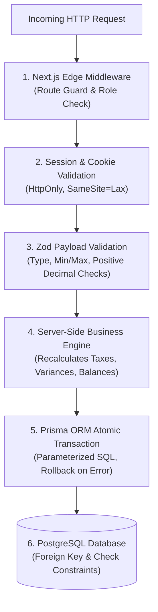

# Security Architecture & Threat Model

## 1. Executive Summary

This document outlines the security architecture, threat model, and defense mechanisms implemented across the Order-to-Audit ERP. Security is designed in depth, extending significantly beyond superficial Role-Based Access Control (RBAC) to protect data integrity, prevent unauthorized access, and ensure statutory audit compliance.

---

## 2. Threat Modeling & Defense Matrix (OWASP Top 10 Mapping)

| Threat Category | Potential Risk Vector | Implemented Defense Mechanism |
| :--- | :--- | :--- |
| **A01: Broken Access Control** | Salesman viewing admin reports; unauthorized user accessing production logs. | Next.js Edge Middleware route guards combined with server-side session and role validation in every Server Action. |
| **A02: Cryptographic Failures** | Plaintext password storage; credential leakage in transit. | Bcrypt/Argon2 password hashing with salt; strict TLS/HTTPS enforcement on Vercel; HTTP-only secure cookies. |
| **A03: Injection (SQL / Command)** | Attacker injecting SQL via order forms or report filters. | 100% parameterized queries via Prisma ORM. Direct raw string interpolation in SQL is strictly prohibited. |
| **A04: Insecure Design** | Negative inventory balance manipulation; tampering with calculated invoice amounts. | Strict server-side Zod validation schemas; calculations performed exclusively on the server (client inputs only item IDs & quantities). |
| **A05: Security Misconfiguration** | Leaked database credentials; exposed staging keys. | Environment variables (`.env`) isolated via Vercel secrets; zero secret commits in Git (`.gitignore` enforced). |
| **A07: Identification & Auth Failures** | Brute force login; session hijacking. | Session tokens stored in `HttpOnly`, `SameSite=Lax`, `Secure` cookies; account lockout / rate limiting on authentication routes. |
| **A08: Software & Data Integrity Failures** | Direct tampering of stock records or deletion of posted tax invoices. | Immutable Stock Ledger design. Invoices cannot be deleted; corrections require explicit Credit Notes or Stock Adjustments. |
| **A09: Security Logging & Monitoring** | Untracked modifications to financial invoices or production formulas. | Complete audit trail columns (`createdAt`, `updatedAt`, `userId`, `notes`) across all transaction and ledger tables. |

---

## 3. Defense-in-Depth Implementation

---

## 4. Key Security Controls

### 4.1 Input Validation & Payload Sanitization (Zod)
Client-side validation is treated strictly as UX guidance. All Server Actions mandate server-side schema verification using **Zod**:
* Enforces positive values for quantities and prices (e.g., `z.number().positive()`).
* Rejects unexpected fields to prevent Mass Assignment vulnerabilities.
* Validates state codes, GSTIN patterns, and email formats.

### 4.2 SQL Injection Immunity
All database interactions flow through **Prisma ORM**, which compiles queries into parameterized SQL statements with bound values.
* User inputs are never concatenated directly into query strings.
* Any complex analytical queries use typed Prisma query APIs or strictly parameterized `$queryRaw`.

### 4.3 Session & Cookie Security
* Authentication sessions are managed using encrypted, signed tokens stored inside HTTP cookies.
* **`HttpOnly` Flag:** Prevents client-side scripts from reading the cookie, neutralizing Cross-Site Scripting (XSS) token theft.
* **`Secure` Flag:** Ensures cookies are only transmitted over HTTPS connections.
* **`SameSite=Lax`:** Protects against Cross-Site Request Forgery (CSRF) attacks.

### 4.4 Non-Destructive Ledger & Audit Trail
In compliance with statutory accounting principles:
* **No `DELETE` operations** are permitted on `Invoice`, `StockLedger`, or `ProductionRun` tables.
* If an order or invoice is cancelled, the system creates a compensating record (e.g., a **Credit Note** or **Stock Adjustment** reversal) linked to the original document ID.
* The historical ledger remains continuous, immutable, and fully verifiable by external auditors.

### 4.5 Secret Management & Zero-Cost Security
* Production credentials (`DATABASE_URL`, `SESSION_SECRET`) are stored in Vercel’s encrypted environment variables.
* Database connections utilize SSL mode (`sslmode=require`) to encrypt all traffic between Vercel serverless functions and Neon PostgreSQL.
